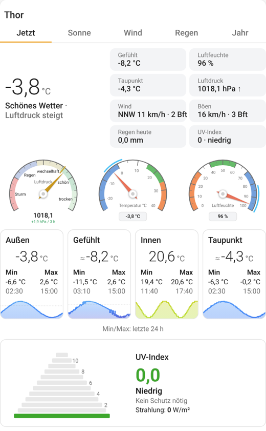
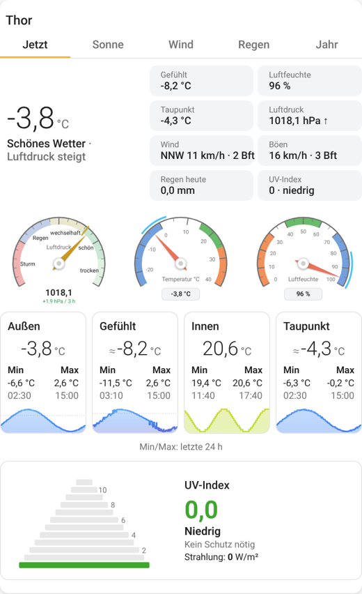
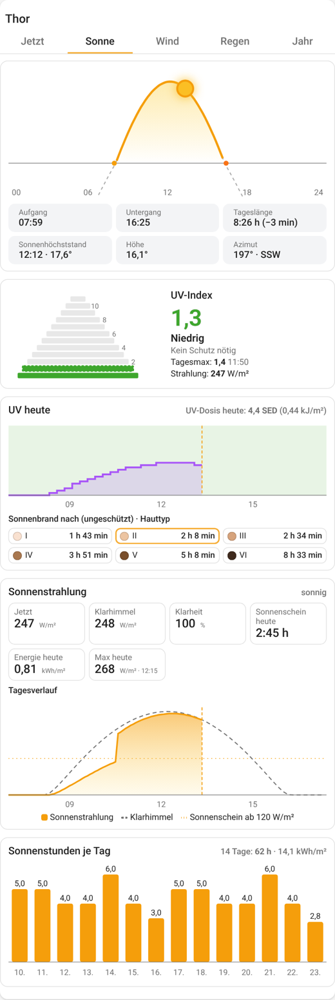
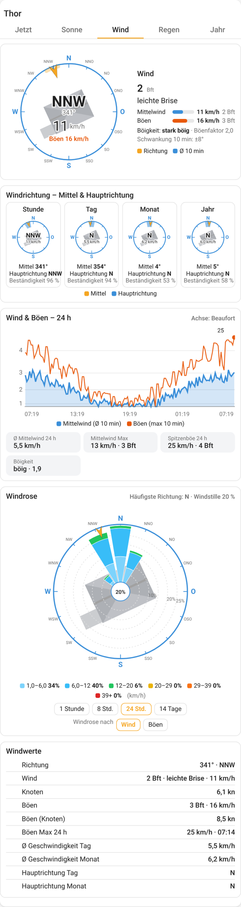
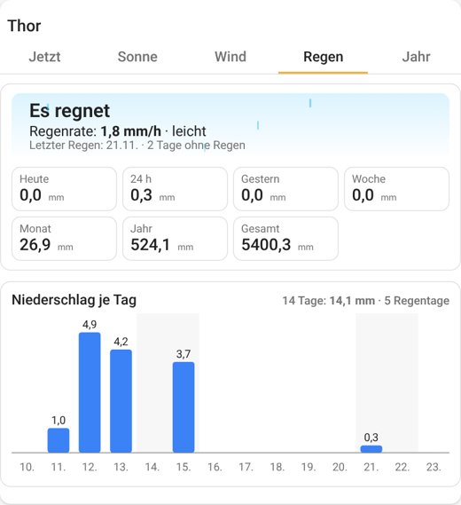
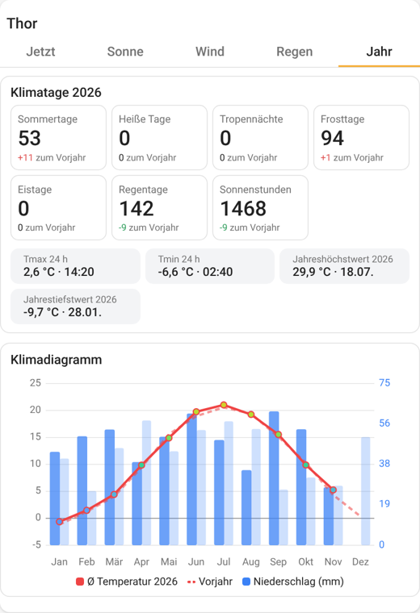

# Thor Weather Card

[](https://hacs.xyz/docs/faq/custom_repositories)
[](https://github.com/muhkuh666/thor-weather-card/actions/workflows/validate.yml)
[](https://github.com/muhkuh666/thor-weather-card/releases)
[](https://buymeacoffee.com/muhkuh666)

🇬🇧 [English](README.md)

⚡ **Die ganze Wetterstation auf einer Karte.** Thor vereint ein klassisches Barometer mit Drucktendenz, Temperatur-Kacheln mit Min/Max, einen Wind-Kompass mit Stunden-/Tages-/Monats-/Jahresmittel, eine Windrose, eine UV-Pyramide, Regensummen und die Klimatage des Jahres – alles aus deinen eigenen Sensoren, ohne Cloud-Dienst.



## Funktionen

**Jetzt**
- Übersicht: Außentemperatur, Kurzprognose aus der Drucktendenz (nach Zambretti-Art: *Schönes Wetter*, *Regen wahrscheinlich*, *Sturm möglich* …) und Chips für gefühlte Temperatur, Luftfeuchte, Taupunkt, Luftdruck, Wind, Regen heute und UV
- **Barometer** mit den klassischen Wörtern *Sturm · Regen · wechselhaft · schön · trocken*, goldenem Zeiger und **Schleppzeiger mit dem Luftdruck von vor 3 Stunden** samt hPa/3 h
- Zeigerinstrumente für Temperatur und Luftfeuchte mit dem **Min–Max-Bereich** der letzten 24 h am Rand
- Temperatur-Kacheln (außen, gefühlt, innen, Taupunkt, Feuchte innen) mit **Min/Max inkl. Uhrzeit** und temperaturfarbigem Verlauf
- **Gefühlte Temperatur und Taupunkt werden berechnet** (Windchill / Hitzeindex, Magnus-Formel), wenn du dafür keine Sensoren hast
- **UV-Pyramide** in WHO-Farben mit Risikostufe, Schutz-Tipp und Tagesmaximum

**Sonne**
- **Sonnenbogen** des Tages mit aktuellem Sonnenstand, Auf- und Untergang, **Tageslänge inkl. Änderung zu gestern**, Sonnenhöchststand mit Höhe, aktuelle Höhe und Azimut (aus dem Standort von Home Assistant berechnet)
- **UV**: Pyramide plus UV-Kurve des Tages in den WHO-Stufen, **UV-Tagesdosis** (SED) und **Zeit bis zum Sonnenbrand** für Hauttyp I–VI (dein Typ hervorgehoben)
- **Sonnenstrahlung**: aktuelle W/m², **Klarhimmel-Wert** und **Klarheit** (sonnig / leicht bewölkt / bewölkt / trüb), **Sonnenscheindauer heute** (WMO: ≥ 120 W/m²), **Energie heute** in kWh/m², Tagesmaximum – mit Tagesverlauf gegen die Klarhimmel-Kurve
- **Sonnenstunden je Tag** (7–60 Tage) und Sonnenstunden des Jahres im Vergleich zum Vorjahr
- Funktioniert mit Strahlungssensor (W/m²) oder Helligkeitssensor (lx, genähert)

**Wind**
- Großer Kompass mit Pfeil, Himmelsrichtung, Geschwindigkeit, Beaufort mit Bezeichnung, **Schwankungsbogen der letzten 10 Minuten** und 10-Minuten-Mittel
- **Wind und Böen klar getrennt**: Vergleichsbalken Mittelwind gegen Böen, **Böigkeit** (gleichmäßig … stark böig) mit Böenfaktor, Böen im Kompass und in der Übersicht
- **Diagramm Wind & Böen (24 h)**: Mittelwind (10-Minuten-Mittel) als Fläche, Böen (10-Minuten-Maximum) als Linie, Beaufort-Achse, Spitzenböe markiert
- **Richtungsmittel für Stunde, Tag, Monat und Jahr** (Vektormittel – nicht das falsche arithmetische Mittel) plus **Hauptrichtung** und **Beständigkeit**
- **Windrose** mit 16 Sektoren, gestapelt nach Beaufort-Klassen, Windstille in der Mitte, wählbaren Zeiträumen (1 Stunde … 30 Tage) und umschaltbar zwischen **Mittelwind und Böen**
- Optional **Hausbild** hinter Kompass und Windrose – gleiche Optionen wie bei der [Helios Compass Card](https://github.com/muhkuh666/helios-compass-card)
- Windwerte-Liste: Grad, Beaufort, km/h · m/s · Knoten · mph, Böen, stärkste Böe der letzten 24 h, Durchschnittsgeschwindigkeiten
- Windeinheit wählbar: wie Sensor, km/h, m/s, kn, mph oder Beaufort

**Regen**
- Regen-Status mit animierten Tropfen, Regenrate und Intensität (leicht / mäßig / stark / sehr stark)
- Summen für **heute, 24 h, gestern, Woche, Monat, Jahr** und gesamt – alles aus **einem** Regen-Zähler berechnet
- Niederschlag je Tag als Balkendiagramm (7–60 Tage), letzter Regen und Tage ohne Regen

**Jahr**
- **Klimatage** seit 1. Januar: Sommertage (≥ 25 °C), Heiße Tage (≥ 30 °C), Tropennächte (Tmin ≥ 20 °C), Frosttage (Tmin < 0 °C), Eistage (Tmax < 0 °C), Regentage – jeweils **im Vergleich zum Vorjahr bis zum selben Datum**
- Tmax/Tmin 24 h sowie Jahreshöchst- und -tiefstwert mit Datum
- **Klimadiagramm**: Monatsmittel der Temperatur und Niederschlag, dieses Jahr gegen Vorjahr

**Allgemein**
- Reiter (*Jetzt · Sonne · Wind · Regen · Jahr*) oder alles untereinander, jeder Bereich abschaltbar
- Komplett im **grafischen Karten-Editor** einstellbar, Deutsch und Englisch, helles & dunkles Theme
- Klick auf einen Wert öffnet den *Mehr-Infos*-Dialog von Home Assistant

## Screenshots

| Jetzt | Sonne | Wind | Regen | Jahr |
|---|---|---|---|---|
|  |  |  |  |  |

## Installation

### HACS
1. HACS → ⋮ → *Benutzerdefinierte Repositories* → `https://github.com/muhkuh666/thor-weather-card`, Typ **Dashboard**
2. *Thor Weather Card* installieren, Browser neu laden (Strg+F5)

### Manuell
`thor-weather-card.js` nach `config/www/` kopieren und als Ressource eintragen: *Einstellungen → Dashboards → ⋮ → Ressourcen* → `/local/thor-weather-card.js` (JavaScript-Modul).

## Konfiguration

Karte über *Karte hinzufügen → Thor Weather Card* einfügen und die Sensoren im Editor auswählen. Minimal-YAML:

```yaml
type: custom:thor-weather-card
outdoor_temp_entity: sensor.aussentemperatur
humidity_entity: sensor.luftfeuchtigkeit
pressure_entity: sensor.luftdruck_relativ
wind_speed_entity: sensor.windgeschwindigkeit
wind_gust_entity: sensor.windboen
wind_direction_entity: sensor.windrichtung
rain_rate_entity: sensor.regenrate
rain_total_entity: sensor.gesamtniederschlag
uv_entity: sensor.uv_index
```

Vollständiges Beispiel:

```yaml
type: custom:thor-weather-card
title: Thor
outdoor_temp_entity: sensor.aussentemperatur
indoor_temp_entity: sensor.innentemperatur
humidity_entity: sensor.luftfeuchtigkeit
pressure_entity: sensor.luftdruck_relativ
wind_speed_entity: sensor.windgeschwindigkeit
wind_gust_entity: sensor.windboen
wind_direction_entity: sensor.windrichtung
rain_rate_entity: sensor.regenrate
rain_total_entity: sensor.gesamtniederschlag
rain_state_entity: sensor.regen
uv_entity: sensor.uv_index
radiation_entity: sensor.sonnenstrahlung
skin_type: 2
layout: tabs            # tabs | stack
default_tab: now        # now | wind | rain | year
wind_unit: auto         # auto | km/h | m/s | kn | mph | bft
windrose_periods: [1h, 8h, 24h, 14d]
windrose_default: 24h
rain_day_threshold: 0.1
image: /local/thor/haus.png
image_rotation: -25
image_opacity: 0.55
```

### Sensoren

| Option | Beschreibung |
|---|---|
| `outdoor_temp_entity` | Außentemperatur (°C oder °F) |
| `feels_like_entity` | Gefühlte Temperatur – *optional, sonst berechnet* |
| `indoor_temp_entity` | Innentemperatur |
| `dew_point_entity` | Taupunkt – *optional, sonst berechnet* |
| `humidity_entity` / `indoor_humidity_entity` | Relative Luftfeuchte außen / innen |
| `pressure_entity` | **Relativer** Luftdruck (auf Meereshöhe) in hPa |
| `wind_speed_entity` / `wind_gust_entity` | Windgeschwindigkeit / Böen (km/h, m/s, kn, mph – wird automatisch umgerechnet) |
| `wind_direction_entity` | Grad 0–360 **oder** Himmelsrichtung als Text (N, NNO, NO …) |
| `rain_rate_entity` | Regenrate (mm/h) |
| `rain_total_entity` | Fortlaufender Regen-Zähler (`state_class: total_increasing`) – **empfohlen** |
| `rain_today_entity` | Täglich zurückgesetzter Regen-Sensor – nur wenn es keinen Gesamt-Zähler gibt |
| `rain_state_entity` | Optional `binary_sensor` oder Text-Sensor („Regen“/„kein Regen“); sonst zählt Regenrate > 0 |
| `uv_entity` | UV-Index |
| `radiation_entity` | Sonnenstrahlung in W/m² (ein Lux-Sensor geht auch, genähert) |
| `illuminance_entity` | Helligkeit in lx – optional, zusätzlich angezeigt / als Ersatz |
| `sun_entity` | `sun.sun` – nur genutzt, wenn Home Assistant keinen Standort hat |

### Optionen

| Option | Standard | Beschreibung |
|---|---|---|
| `layout` | `tabs` | `tabs` (Reiter) oder `stack` (alles untereinander) |
| `tabs` | `[now, sun, wind, rain, year]` | Welche Reiter/Abschnitte in welcher Reihenfolge |
| `default_tab` | `now` | Start-Reiter |
| `show_hero`, `show_gauges`, `show_temps`, `show_uv`, `show_compass`, `show_wind_averages`, `show_windrose`, `show_wind_values`, `show_gust_chart`, `show_sun_arc`, `show_sun_uv`, `show_radiation`, `show_sun_chart`, `show_rain`, `show_rain_chart`, `show_climate_days`, `show_climate_chart` | `true` | Einzelne Bereiche ein-/ausblenden |
| `minmax_mode` | `24h` | Min/Max über die letzten 24 h oder `today` (seit Mitternacht) |
| `wind_unit` | `auto` | `auto`, `km/h`, `m/s`, `kn`, `mph`, `bft` |
| `windrose_periods` | `[1h, 8h, 24h, 14d]` | Beliebig aus `1h 3h 8h 12h 24h 3d 7d 14d 30d` |
| `windrose_mode` | `wind` | Windrose nach `wind` (Mittelwind) oder `gust` (Böen) |
| `skin_type` | `2` | Hauttyp I–VI (1–6) für die Sonnenbrandzeit |
| `sunshine_threshold` | `120` | Ab wie viel W/m² Sonnenschein zählt (WMO) |
| `sun_days` | `14` | Tage im Sonnenstunden-Diagramm (7–60) |
| `rain_days` | `14` | Tage im Regen-Diagramm (7–60) |
| `rain_day_threshold` | `0.1` | Ab wie viel mm ein Tag als Regentag zählt |
| `pressure_offset` | `0` | hPa, die zum Messwert addiert werden (Höhenkorrektur) |
| `temp_gauge_min` / `temp_gauge_max` | `-25` / `40` | Skala des Temperatur-Instruments (°C) |
| `image`, `image_scale`, `image_rotation`, `image_opacity`, `image_clip` | | Hausbild hinter Kompass & Windrose – Norden des Bildes nach oben |
| `language` | `auto` | `auto`, `de`, `en` |
| `refresh_minutes` | `5` | Wie oft der Verlauf neu geladen wird |

### Hinweise
- **Verlauf & Statistik:** Min/Max, Verlaufskurven, Windrose sowie Stunden-/Tagesmittel kommen aus dem Recorder-Verlauf (`purge_keep_days` mindestens so groß wie der längste Windrosen-Zeitraum). Monats-/Jahresmittel, Regen je Tag, Klimatage und Klimadiagramm nutzen die **Langzeitstatistik** – die Sensoren brauchen eine `state_class` (`measurement` für Temperatur und Wind, `total_increasing` für den Regen-Zähler). Windrichtungs-Sensoren mit `state_class: measurement_angle` liefern exakte (kreisförmige) Stundenmittel.
- Der Prognose-Text ist eine einfache Barometer-Faustregel (Druckniveau + 3-Stunden-Tendenz), keine Wetterdienst-Vorhersage.

## Unterstützung

Wenn dir die Karte gefällt, freue ich mich über einen Kaffee ☕

[](https://buymeacoffee.com/muhkuh666)

## Lizenz

MIT © muhkuh666
