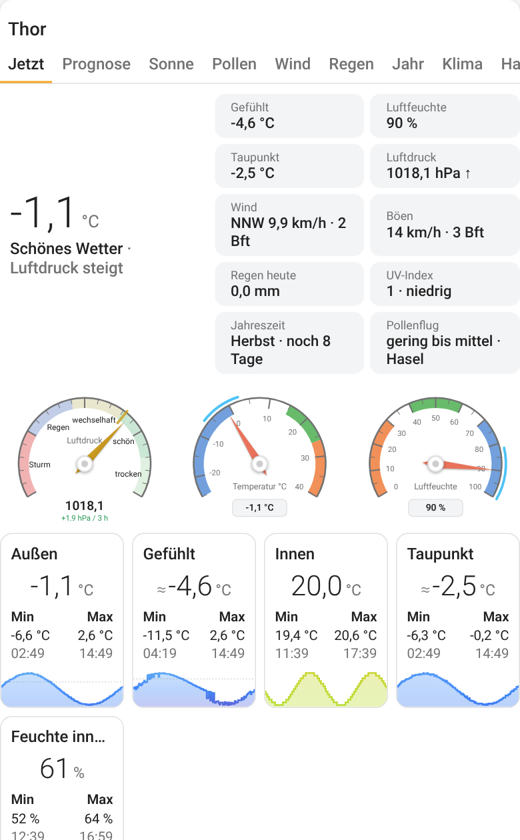
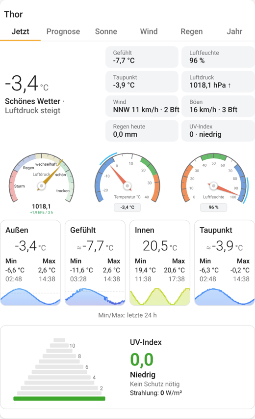
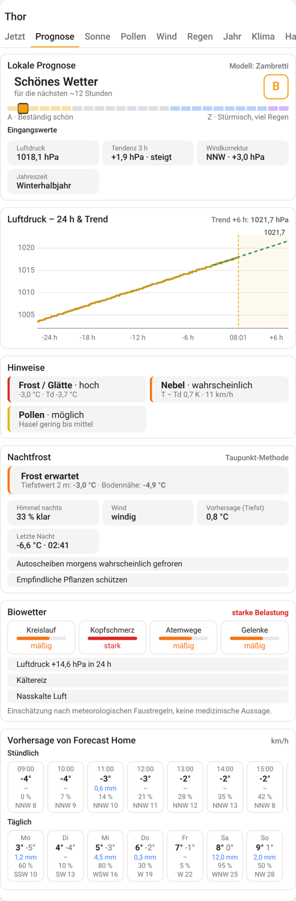
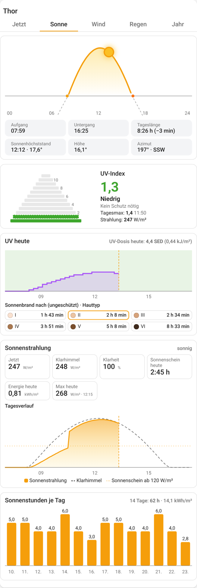
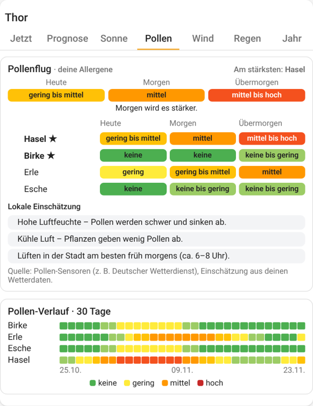
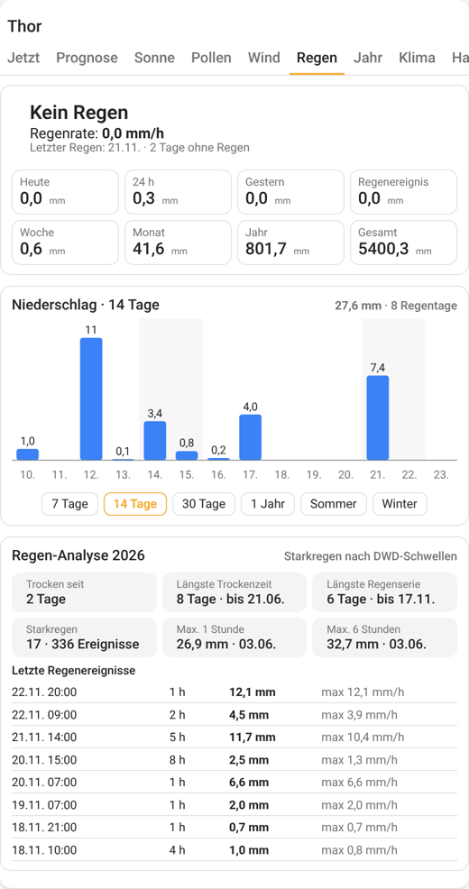
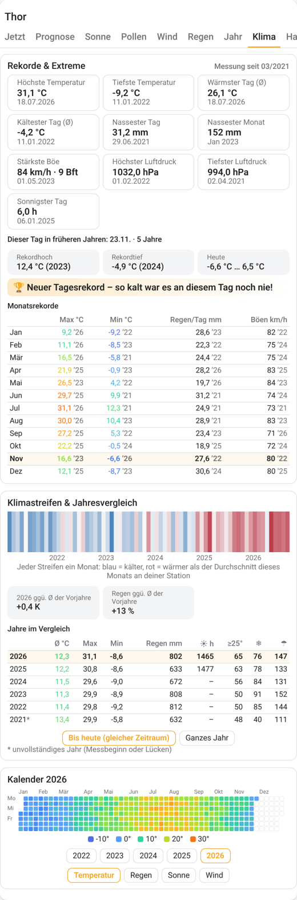
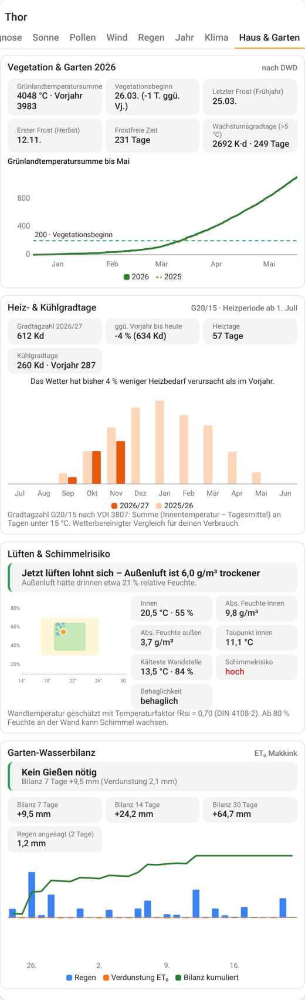

# Thor Weather Card

[](https://hacs.xyz/docs/faq/custom_repositories)
[](https://github.com/muhkuh666/thor-weather-card/actions/workflows/validate.yml)
[](https://github.com/muhkuh666/thor-weather-card/releases)
[](https://buymeacoffee.com/muhkuh666)

🇩🇪 [Deutsche Anleitung](README.de.md)

⚡ **Your whole weather station on one card.** Thor combines a classic barometer with pressure trend, temperature tiles with min/max, a wind compass with hourly/daily/monthly/yearly means, a wind rose, a UV pyramid, rain totals and the climate days of the year – all from your own sensors, no cloud service needed.



## Features

**Now**
- Overview: outdoor temperature, a short forecast from the pressure trend (Zambretti-style: *fair weather*, *rain likely*, *storm possible* …) and chips for feels-like, humidity, dew point, pressure, wind, rain today and UV
- **Barometer** with the classic words *Stormy · Rain · Change · Fair · Very dry*, a golden needle and a **drag pointer showing the pressure 3 hours ago** plus hPa/3 h
- Dial gauges for temperature and humidity with the **min–max range** of the last 24 h on the rim
- Temperature tiles (outdoor, feels-like, indoor, dew point, indoor humidity) with **min/max incl. time** and a temperature-coloured sparkline
- **Feels-like and dew point are computed** automatically (wind chill / heat index, Magnus formula) if you don't have sensors for them
- **UV pyramid** in WHO colours with risk level, protection tip and daily maximum

**Forecast**
- **Local forecast with the Zambretti model** (Negretti & Zambra): pressure, 3‑hour trend, wind direction and season give one of 26 forecasts from *A – Settled fine* to *Z – Stormy, much rain*, with scale and all inputs shown; also used in the overview
- **Pressure chart 24 h with trend** extrapolated 6 hours ahead
- **Alerts**: fog, frost / black ice, dew, storm (gusts or rapid pressure fall), thunderstorm tendency, heat and UV – each with level and the values behind it
- Optional **forecast of a weather entity** (e.g. Met.no, DWD): hourly and daily with temperature, precipitation, probability and wind

**Season**
- Current **meteorological** and **astronomical** season (equinoxes and solstices to the minute, Meeus), year ring with progress, days until the next season, day length change
- The running season so far **vs. the same period of earlier years** (temperature, rain, sunshine, frost/summer days) and a **seasons compared** table with anomalies
- Season chip in the overview and a **Season** period button for wind rose, wind & gusts, precipitation and sunshine

**Climate** *(from your long-term statistics, up to 30 years back)*
- **Records & extremes**: highest/lowest temperature, warmest/coldest day, wettest day and month, strongest gust, highest/lowest pressure, sunniest day – plus **this calendar day in earlier years** with a 🏆 when today sets a new record, and a **monthly records** table
- **Climate stripes** of your own station (each month vs. its average) and a **year comparison** table – year to date (fair) or whole years: mean, extremes, rain, sunshine, summer/frost/rain days
- **Calendar heatmap**: the whole year day by day for temperature, rain, sunshine or gusts, selectable years

**Home & garden**
- **Vegetation**: grassland temperature sum and start of vegetation (DWD, 200 °C) vs. last year, last spring and first autumn frost, frost-free period, growing degree days
- **Heating & cooling degree days** (G20/15, VDI 3807) per month for the heating season vs. last season – "the weather caused 4 % less heating demand"
- **Ventilation & mould risk**: absolute humidity indoor vs. outdoor ("airing pays off now"), indoor dew point, estimated coldest wall spot (fRsi) with mould risk, comfort diagram with the last 24 h
- **Garden water balance**: rain minus evaporation (ET₀ Makkink from your radiation sensor, otherwise Hargreaves) over 7/14/30 days with a watering recommendation that considers forecast rain

**More in Forecast & Rain**
- **Night frost forecast** (dew point method, sky and wind, combined with the weather entity forecast): minimum at 2 m and near the ground, tips for car, plants, pipes, black ice
- **Biometeorology**: circulation, headache, airways, joints from pressure and temperature jumps, heat, sultriness, cold stimulus, damp cold and pollen
- **Rain analysis**: heavy rain per DWD thresholds (1 h / 6 h), recent rain events with duration and intensity, longest dry and wet spells

**Pollen**
- Works out of the box with **[DWD Pollenflug](https://github.com/mampfes/hacs_dwd_pollenflug)** (sensors are found automatically); other sources (Google Pollen UPI 0–5, grains/m³, text levels) are converted to the same 0–3 scale
- Today, tomorrow and the day after per pollen type, overall level and trend; **your allergens** are highlighted and drive the overall level, the overview chip and the alerts
- **Local assessment from your station**: rain washes pollen out, high humidity lets it settle, dry wind spreads it – plus an airing tip for town or countryside
- **Pollen history** as a heatmap (7–90 days)

**Sun**
- **Sky compass**: a separate compass for sun and moon (with your house image) – sun path with hour marks and sunrise/sunset, moon arc with moonrise/moonset, sun paths of 21 June / 21 December, elevation rings 30°/60°
- **Sun & moon** like a horizon card: sun and moon path over the day with night and twilight shading, sunrise/sunset, dawn and dusk (civil, nautical or astronomical), solar noon, azimuth and elevation of sun ☉ and moon ☽, moonrise/moonset, moon phase with picture and illumination
- **Sun arc** of the day with the current sun position, sunrise, sunset, **day length incl. change vs. yesterday**, solar noon with maximum elevation, elevation and azimuth (computed from your Home Assistant location)
- **UV**: pyramid plus today's UV curve in the WHO bands, **daily UV dose** (SED) and **time until sunburn** for skin types I–VI (your type highlighted)
- **Solar radiation**: current W/m², **clear-sky value** and **clearness** (sunny / partly cloudy / cloudy / overcast), **sunshine duration today** (WMO: ≥ 120 W/m²), **energy today** in kWh/m², daily max – with a daily curve against the clear-sky curve
- **Sunshine hours per day** (7–60 days) and sunshine hours of the year compared with last year
- Works with a radiation sensor (W/m²) or an illuminance sensor (lx, approximated)

**Wind**
- Large compass with arrow, cardinal point, speed, Beaufort with description, the **10‑minute variation arc** and the 10‑minute mean
- **Beaufort columns** for mean wind and gusts (0–12 in the classic colours) with the current value, the 24 h maximum and a legend with names and speed ranges
- **Wind and gusts clearly separated**: comparison bars mean wind vs. gusts, **gustiness** (steady … very gusty) with gust factor, gusts in the compass and in the overview
- **Wind & gusts chart (24 h)**: 10‑minute mean wind as area, 10‑minute max gust as line, Beaufort axis, peak gust marked
- **Direction means for hour, day, month and year** (vector mean, not the wrong arithmetic mean) plus **prevailing direction** and **steadiness**
- **Wind rose** switchable in the card between **frequency**, **speed** and **force (Beaufort)** – speed/force show the mean per direction, the maximum as an arc and the frequency as opacity; current wind, gusts and Beaufort always shown above the rose
- **Sky map of sun and moon** on the wind rose and the wind compass (like the Helios Compass Card): rim = horizon, centre = zenith; today's sun path with hour marks and sunrise/sunset times, the current or next moon arc with hour marks and moonrise/moonset times, sun and moon (in its real phase) at their actual sky position, optional sun paths of 21 June / 21 December; azimuth, elevation, moon phase and illumination below the rose
- 16 sectors stacked by Beaufort class, calm percentage in the centre, selectable periods (1 h … 30 days) and switchable between **mean wind and gusts**
- Optional **house image** behind compass and wind rose – same options as the [Helios Compass Card](https://github.com/muhkuh666/helios-compass-card)
- Wind values list: degrees, Beaufort, km/h · m/s · knots · mph, gusts, max gust in 24 h, average speeds
- Wind unit selectable: as sensor, km/h, m/s, kn, mph or Beaufort

**Rain**
- Rain status with animated drops, rain rate and intensity (light / moderate / heavy / very heavy)
- Totals for **today, 24 h, yesterday, week, month, year** and total – all derived from **one** rain counter
- Precipitation per day as a bar chart (7–60 days), last rain and days without rain

**Year**
- **Climate days** since 1 January: summer days (≥ 25 °C), hot days (≥ 30 °C), tropical nights (min ≥ 20 °C), frost days (min < 0 °C), ice days (max < 0 °C), rain days – each **compared with last year to date**
- Tmax/Tmin 24 h and the year's high and low with date
- **Climate chart**: monthly mean temperature and precipitation, this year vs. last year

**Periods (like the Helios Compass Card)**
- Buttons *Today · 1 hr · 8 hrs · 12 hrs · 24 hrs · 3/7/14/30 days · 1 year · Summer · Winter* on wind rose, wind & gusts, precipitation and sunshine hours
- Short periods come from the history, from 7 days on from the long-term statistics; *Summer* = Apr–Sep, *Winter* = Oct–Mar of the last 12 months; 1 year / summer / winter as monthly bars
- The last selection is remembered per chart

**General**
- Tabs (*Now · Forecast · Sun · Pollen · Wind · Rain · Year · Climate · Home & garden*), scrollable – the pollen tab only appears when pollen sensors exist
- **Every option** can be set in the visual editor, incl. colours (accent, wind, gusts, needle) or everything stacked, each section can be switched off
- Fully configurable in the **visual card editor**, German and English, light & dark themes
- Click any value to open the Home Assistant *more info* dialog

## Screenshots

| Now | Forecast | Sun | Pollen | Wind | Rain | Year | Climate | Home |
|---|---|---|---|---|---|---|---|---|
|  |  |  |  |  |  |  |  |  |

## Notifications (blueprints)

| Blueprint | What it does | Import |
|---|---|---|
| Frost | Evening warning when frost is likely tonight (dew point method) and when it freezes | [](https://my.home-assistant.io/redirect/blueprint_import/?blueprint_url=https%3A%2F%2Fgithub.com%2Fmuhkuh666%2Fthor-weather-card%2Fblob%2Fmain%2Fblueprints%2Fautomation%2Fmuhkuh666%2Fthor_frost.yaml) |
| Storm | Gusts above a limit (default 62 km/h) and optionally rapid pressure fall | [](https://my.home-assistant.io/redirect/blueprint_import/?blueprint_url=https%3A%2F%2Fgithub.com%2Fmuhkuh666%2Fthor-weather-card%2Fblob%2Fmain%2Fblueprints%2Fautomation%2Fmuhkuh666%2Fthor_storm.yaml) |
| Rain | Rain start after a dry period, heavy rain above a rain rate | [](https://my.home-assistant.io/redirect/blueprint_import/?blueprint_url=https%3A%2F%2Fgithub.com%2Fmuhkuh666%2Fthor-weather-card%2Fblob%2Fmain%2Fblueprints%2Fautomation%2Fmuhkuh666%2Fthor_rain.yaml) |
| Pollen | Morning message for your allergens, evening forecast for tomorrow | [](https://my.home-assistant.io/redirect/blueprint_import/?blueprint_url=https%3A%2F%2Fgithub.com%2Fmuhkuh666%2Fthor-weather-card%2Fblob%2Fmain%2Fblueprints%2Fautomation%2Fmuhkuh666%2Fthor_pollen.yaml) |

## Installation

### HACS
1. HACS → ⋮ → *Custom repositories* → `https://github.com/muhkuh666/thor-weather-card`, type **Dashboard**
2. Install *Thor Weather Card*, reload the browser (Ctrl+F5)

### Manual
Copy `thor-weather-card.js` to `config/www/` and add it as a resource: *Settings → Dashboards → ⋮ → Resources* → `/local/thor-weather-card.js` (JavaScript module).

## Configuration

Add the card via *Add card → Thor Weather Card* and pick your sensors in the editor. Minimal YAML:

```yaml
type: custom:thor-weather-card
outdoor_temp_entity: sensor.outdoor_temperature
humidity_entity: sensor.outdoor_humidity
pressure_entity: sensor.relative_pressure
wind_speed_entity: sensor.wind_speed
wind_gust_entity: sensor.wind_gust
wind_direction_entity: sensor.wind_direction
rain_rate_entity: sensor.rain_rate
rain_total_entity: sensor.rain_total
uv_entity: sensor.uv_index
```

Full example:

```yaml
type: custom:thor-weather-card
title: Thor
outdoor_temp_entity: sensor.outdoor_temperature
indoor_temp_entity: sensor.indoor_temperature
humidity_entity: sensor.outdoor_humidity
pressure_entity: sensor.relative_pressure
wind_speed_entity: sensor.wind_speed
wind_gust_entity: sensor.wind_gust
wind_direction_entity: sensor.wind_direction
rain_rate_entity: sensor.rain_rate
rain_total_entity: sensor.rain_total
rain_state_entity: binary_sensor.raining
uv_entity: sensor.uv_index
radiation_entity: sensor.solar_radiation
skin_type: 2
layout: tabs            # tabs | stack
default_tab: now        # now | wind | rain | year
wind_unit: auto         # auto | km/h | m/s | kn | mph | bft
windrose_periods: [today, 1h, 8h, 24h, 7d, 30d, season, 1y, summer, winter]
windrose_default: 24h
rain_day_threshold: 0.1
image: /local/thor/house.png
image_rotation: -25
image_opacity: 0.55
```

### Sensors

| Option | Description |
|---|---|
| `outdoor_temp_entity` | Outdoor temperature (°C or °F) |
| `feels_like_entity` | Feels-like temperature – *optional, computed otherwise* |
| `indoor_temp_entity` | Indoor temperature |
| `dew_point_entity` | Dew point – *optional, computed otherwise* |
| `humidity_entity` / `indoor_humidity_entity` | Relative humidity outdoor / indoor |
| `pressure_entity` | **Relative** (sea-level) pressure in hPa |
| `wind_speed_entity` / `wind_gust_entity` | Wind speed / gusts (km/h, m/s, kn, mph – converted automatically) |
| `wind_direction_entity` | Degrees 0–360 **or** compass text (N, NNE, NO …) |
| `rain_rate_entity` | Rain rate (mm/h) |
| `rain_total_entity` | Ever-increasing rain counter (`state_class: total_increasing`) – **recommended** |
| `rain_today_entity` | Daily-resetting rain sensor – only if there is no total counter |
| `rain_state_entity` | Optional `binary_sensor` or text sensor ("rain"/"no rain"); otherwise rain rate > 0 |
| `rain_event_entity` | Rain of the current event ("event rain") |
| `rain_week_entity`, `rain_month_entity`, `rain_year_entity` | Station totals – take precedence over the calculation |
| `wind_dir_avg_hour/day/month/year_entity`, `wind_speed_avg_hour/day/month/year_entity` | Ready-made wind means of the station – replace the computed means (useful if the direction is only text like "N") |
| `uv_entity` | UV index |
| `radiation_entity` | Solar radiation in W/m² (a lux sensor also works, approximated) |
| `illuminance_entity` | Illuminance in lx – optional, shown in addition / fallback |
| `sun_entity` | `sun.sun` – only used if Home Assistant has no location |

### Options

| Option | Default | Description |
|---|---|---|
| `layout` | `tabs` | `tabs` or `stack` (all sections one after another) |
| `tabs` | `[now, forecast, sun, pollen, wind, rain, year, climate, air, home]` | Which tabs/sections and in which order |
| `default_tab` | `now` | Tab shown first |
| `show_hero`, `show_gauges`, `show_temps`, `show_uv`, `show_compass`, `show_wind_averages`, `show_windrose`, `show_wind_values`, `show_gust_chart`, `show_sun_arc`, `show_sun_uv`, `show_radiation`, `show_sun_chart`, `show_rain`, `show_rain_chart`, `show_climate_days`, `show_climate_chart` | `true` | Switch individual sections on/off |
| `minmax_mode` | `24h` | Min/max over the last 24 h or `today` (since midnight) |
| `wind_unit` | `auto` | `auto`, `km/h`, `m/s`, `kn`, `mph`, `bft` |
| `windrose_periods` | `[today, 1h, 8h, 24h, 7d, 30d, season, 1y, summer, winter]` | Period buttons of the wind rose |
| `wind_chart_periods` | `[today, 8h, 24h, 3d, 7d, 30d, season, 1y]` | Period buttons of the wind & gusts chart |
| `rain_periods` / `sun_periods` | `[7d, 14d, 30d, season, 1y, summer, winter]` | Period buttons of the precipitation / sunshine chart |
| `windrose_default`, `wind_chart_default`, `rain_default`, `sun_default` | `24h`, `24h`, `14d`, `14d` | Period shown first (the last choice is remembered in the browser) |
| `show_season`, `show_season_chip`, `show_bft_scale` | `true` | Season panel (Year tab), season chip in the overview, Beaufort columns |
| `season_type` | `meteo` | Season shown first: `meteo` (1 March, 1 June …) or `astro` (equinox/solstice) |
| `climate_years` | `10` | Years of long-term statistics for records, stripes, calendar (2–30) |
| `show_records`, `show_stripes`, `show_calendar`, `show_vegetation`, `show_degree_days`, `show_indoor_climate`, `show_water_balance`, `show_night_frost`, `show_bio`, `show_rain_analysis` | `true` | Analyses on/off |
| `heating_indoor` / `heating_limit` / `cooling_base` | `20` / `15` / `18` | Degree days G20/15 and cooling degree days (°C) |
| `mold_frsi` | `0.7` | Wall temperature factor for the mould risk (DIN 4108-2: 0.7) |
| `pollen_entities` | auto | Pollen sensors – empty = all `sensor.pollenflug_*` (DWD Pollenflug) |
| `pollen_allergies` | | Your allergens – highlighted, determine the overall level |
| `pollen_scale` | `auto` | `auto`, `dwd` (0–3), `upi` (0–5), `ppm` (grains/m³) |
| `pollen_area` | `city` | `city` or `rural` – airing tip |
| `pollen_history_days` | `30` | Days in the pollen heatmap (7–90) |
| `pollen_auto`, `pollen_show_empty`, `show_pollen`, `show_pollen_history` | `true`, `false`, `true`, `true` | Auto-detection, show pollen without flight, sections |
| `weather_entity` | | Weather entity whose forecast is shown in the *Forecast* tab |
| `forecast_model` | `zambretti` | `zambretti` or `simple` (pressure + trend only) |
| `hemisphere` | `auto` | `auto` (from location), `north`, `south` – for Zambretti |
| `forecast_hours` / `forecast_days` | `12` / `7` | Length of the hourly / daily forecast |
| `show_zambretti`, `show_pressure_chart`, `show_risks`, `show_weather_forecast` | `true` | Sections of the *Forecast* tab |
| `windrose_metric` | `freq` | Wind rose shows `freq` (frequency), `speed` or `bft` (force) |
| `show_moon_arc` | `true` | Moon in the *Sun & moon* panel |
| `twilight` | `civil` | Dawn/dusk: `civil` (−6°), `nautical` (−12°), `astronomical` (−18°) |
| `show_rose_sun`, `show_rose_moon` | `false` | Sun / moon (position and path) on the wind rose |
| `show_rose_solstices` | `true` | Sun paths of 21 June and 21 December |
| `show_sky_compass` | `true` | Separate sky compass in the *Sun* tab |
| `sky_on_compass` | `false` | Sun & moon also on the wind compass |
| `show_rose_metric_switch`, `show_rose_now` | `true` | Switch in the card / current wind above the rose |
| `accent_color`, `wind_color`, `gust_color`, `needle_color` | | Colours (hex) |
| `windrose_mode` | `wind` | Wind rose by `wind` (mean wind) or `gust` |
| `skin_type` | `2` | Skin type I–VI (1–6) for the sunburn time |
| `sunshine_threshold` | `120` | W/m² from which it counts as sunshine (WMO) |
| `rain_day_threshold` | `0.1` | mm from which a day counts as a rain day |
| `pressure_offset` | `0` | hPa added to the reading (altitude correction) |
| `temp_gauge_min` / `temp_gauge_max` | `-25` / `40` | Scale of the temperature gauge (°C) |
| `image`, `image_scale`, `image_rotation`, `image_opacity`, `image_clip` | | House image behind compass & wind rose – north of the image up |
| `language` | `auto` | `auto`, `de`, `en` |
| `refresh_minutes` | `5` | How often the history is reloaded |

### Notes
- **History & statistics:** min/max, sparklines, wind rose and hour/day means come from the recorder history (keep `purge_keep_days` ≥ the longest wind-rose period). Month/year means, rain per day, climate days and the climate chart use the **long-term statistics** – the sensors need a `state_class` (`measurement` for temperature, wind; `total_increasing` for the rain counter). Wind direction sensors with `state_class: measurement_angle` give exact circular hourly means.
- A wind direction given as text (N, NNE …) has no long-term statistics: the wind rose from 7 days on then needs a degree sensor; the direction means can come from the station sensors.
- The forecast text is a simple barometric rule of thumb (pressure level + 3‑hour trend), not a weather service forecast.

## Support

If you like the card, I'd be happy about a coffee ☕

[](https://buymeacoffee.com/muhkuh666)

## License

MIT © muhkuh666
